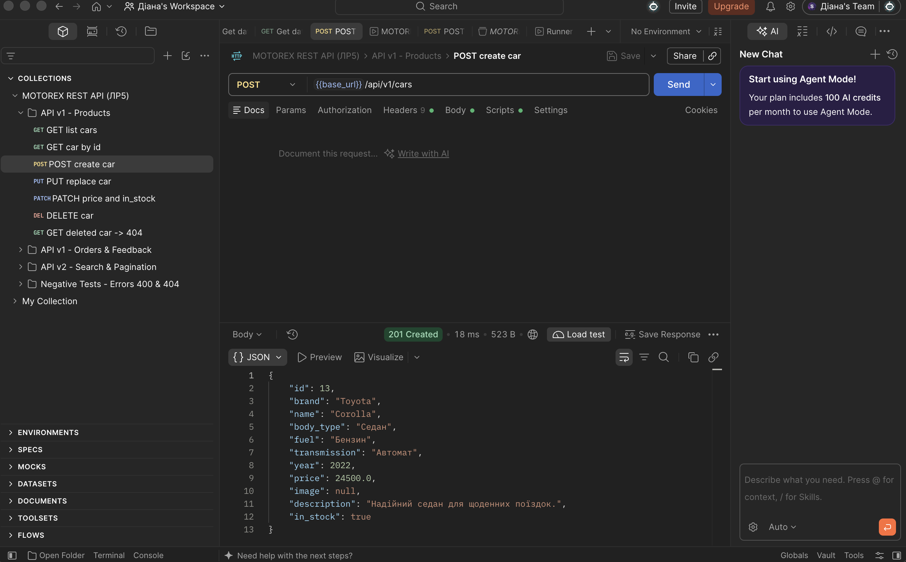
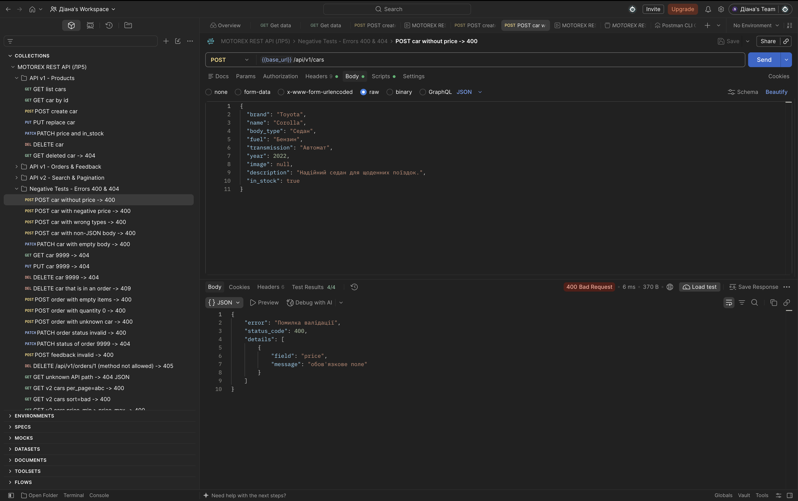
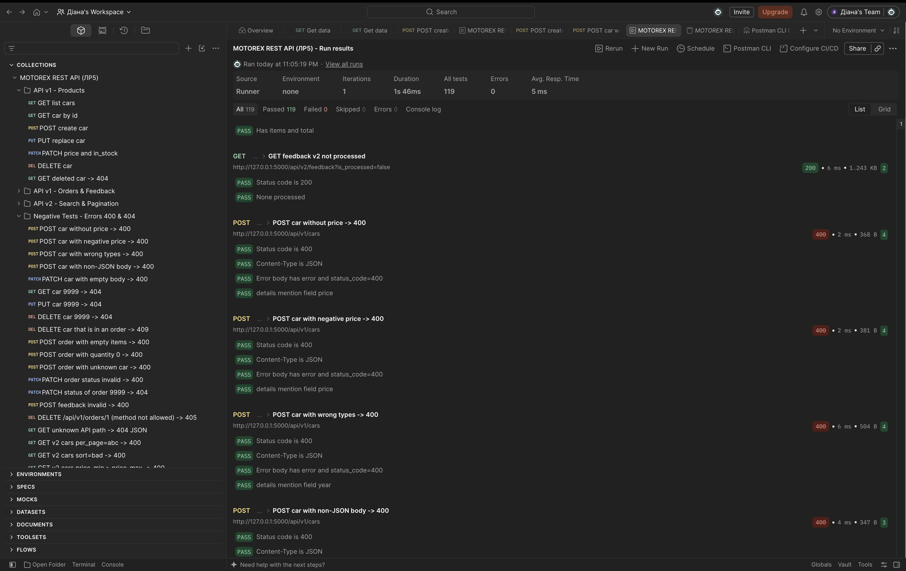
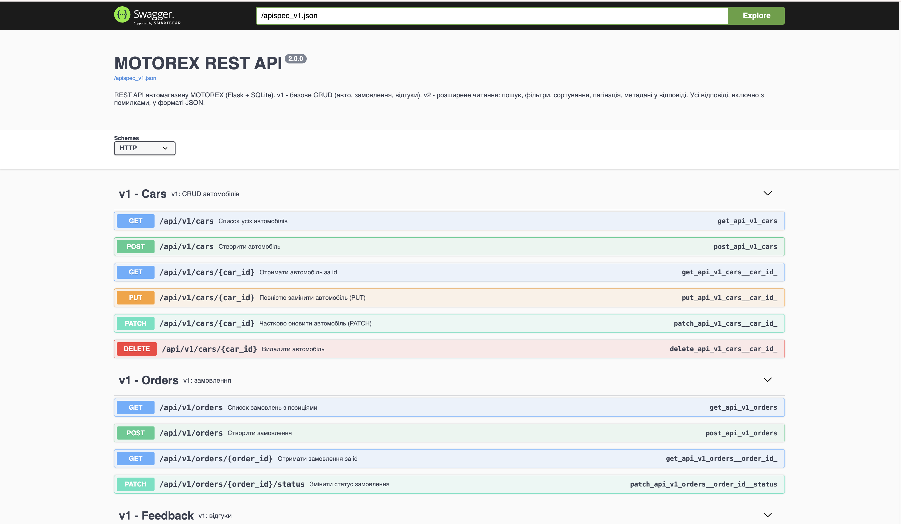

# MOTOREX: вебзастосунок автомагазину + REST API

Навчальний проєкт групи ІПЗ-22 (Flask + SQLite). Лабораторна робота №5: «Розробка RESTful API з документацією» (рівні 1, 2 і 3).

**Команда:** Хомич Максим Віталійович, Жук Діана Валеріївна, Сієнко Володимир Павлович.
**Репозиторій:** https://github.com/Maksimka111222/auto_shop

## Про проєкт

MOTOREX має два інтерфейси до однієї бази SQLite. Перший — сайт із каталогом, кошиком, адмін-панеллю та особистим кабінетом (ЛР3, ЛР4). Другий — REST API, який віддає ті самі дані у форматі JSON (ЛР5). API підключене окремими Blueprint-ами, тому сайт працює як і раніше.

## Технології

| Що | Навіщо |
|---|---|
| Python 3, Flask 3 | вебфреймворк, Blueprint-и |
| SQLite (`sqlite3`) | база даних з ЛР4 |
| flasgger | Swagger UI на основі YAML-докстрінгів |
| Postman | тестування API (`postman_collection.json`) |
| unittest | автотести (`tests/test_app.py`, `tests/test_api.py`) |

## Запуск

```bash
git clone https://github.com/Maksimka111222/auto_shop.git
cd auto_shop
python -m venv .venv
.venv\Scripts\activate          # macOS/Linux: source .venv/bin/activate
pip install -r requirements.txt
rm db.sqlite                     # Windows (PowerShell): del db.sqlite
python seed_data.py              # тестові дані: 9 авто, 2 користувачі, замовлення, відгук
python app.py
```

- Сайт: http://127.0.0.1:5000/
- Swagger UI: http://127.0.0.1:5000/apidocs/ (список угорі перемикає v1 і v2)
- Автотести: `python -m unittest -v`

Якщо при запуску з'являється `ModuleNotFoundError: No module named 'pkg_resources'`, виконайте `pip install "setuptools<82"`.

## Структура API

```text
app.py                 створення застосунку, Swagger, централізовані обробники помилок
models.py              робота з БД (ЛР4) + функції для API в кінці файлу
swagger_config.py      заголовок Swagger і схеми (definitions)
routes/api_common.py   валідація, ApiError, серіалізація, пагінація
routes/api_v1.py       /api/v1: базовий CRUD
routes/api_v2.py       /api/v2: пошук, фільтри, сортування, пагінація
tests/test_api.py      автотести API
postman_collection.json
```

## Ендпоінти

### v1 (`/api/v1`): базовий CRUD

| Метод | URI | Опис | Коди відповідей |
|---|---|---|---|
| GET | `/api/v1/cars` | Список усіх авто | 200 |
| GET | `/api/v1/cars/<id>` | Одне авто | 200, 404 |
| POST | `/api/v1/cars` | Створити авто | 201 (+Location), 400 |
| PUT | `/api/v1/cars/<id>` | Повністю замінити авто | 200, 400, 404 |
| PATCH | `/api/v1/cars/<id>` | Частково оновити (наприклад, ціну, наявність) | 200, 400, 404 |
| DELETE | `/api/v1/cars/<id>` | Видалити авто | 204, 404, 409 |
| GET | `/api/v1/orders` | Замовлення з позиціями (`?status=`) | 200, 400 |
| GET | `/api/v1/orders/<id>` | Одне замовлення | 200, 404 |
| POST | `/api/v1/orders` | Створити замовлення | 201 (+Location), 400, 409 |
| PATCH | `/api/v1/orders/<id>/status` | Змінити статус | 200, 400, 404 |
| GET | `/api/v1/feedback` | Список відгуків | 200 |
| GET | `/api/v1/feedback/<id>` | Один відгук | 200, 404 |
| POST | `/api/v1/feedback` | Залишити відгук | 201 (+Location), 400 |

### v2 (`/api/v2`): розширене читання

| Метод | URI | Опис | Коди відповідей |
|---|---|---|---|
| GET | `/api/v2/cars` | Пошук `q`, фільтри, `sort`, пагінація | 200, 400 |
| GET | `/api/v2/cars/<id>` | Одне авто з `links.self` | 200, 404 |
| GET | `/api/v2/orders` | Замовлення: `status`, пагінація | 200, 400 |
| GET | `/api/v2/orders/<id>` | Одне замовлення з `links.self` | 200, 404 |
| GET | `/api/v2/feedback` | Відгуки: `is_processed`, пагінація | 200, 400 |

Недозволений метод на існуючій адресі повертає 405, будь-яка неіснуюча адреса під `/api/` повертає 404. Обидва випадки у форматі JSON.

## Відмінності v1 і v2

| | v1 | v2 |
|---|---|---|
| Формат списку | масив `[...]` | об'єкт `{"items": [...], "total": 9, "page": 1, "per_page": 10, "pages": 1}` |
| Пошук і фільтри | немає | `q`, `brand`, `body_type`, `fuel`, `transmission`, `price_min`, `price_max`, `in_stock` |
| Сортування | за замовчуванням | `sort=new / price_asc / price_desc / name` |
| Пагінація | немає | `page` (від 1), `per_page` (1-50, за замовчуванням 10) |
| Посилання | немає | `links.self` у кожному об'єкті |
| Запис (POST, PUT, PATCH, DELETE) | є | немає, використовується v1 |

Формат відповіді списку змінився несумісно, тому це окрема версія. Клієнти v1 продовжують працювати без змін.

## Формат помилок і валідація

Усі помилки на `/api/...` повертаються як JSON, а не HTML:

```json
{
  "error": "Помилка валідації",
  "status_code": 400,
  "details": [
    {"field": "price", "message": "обов'язкове поле"}
  ]
}
```

Валідація (`routes/api_common.py`) працює так:

1. `request.get_json(silent=True)` повертає `None`, якщо Content-Type не JSON або JSON зламаний. Тоді відповідь 400. Тіло має бути JSON-об'єктом.
2. Перевіряються обов'язкові поля й типи (`str`, `int`, `float`). `true` і `false` не приймаються як числа.
3. Невідомі поля відхиляються (суворий режим).
4. Ціна має бути більшою за 0, рік від 1950 до 2100, кількість у замовленні від 1 до 5, а марка, модель та ім'я не порожні.
5. Тип кузова, пальне, коробка й статус замовлення мають бути зі списків у `models.py`.
6. Усі знайдені помилки повертаються одразу списком `details`, а не по одній.
7. У замовленні кожне авто має існувати (інакше 400) і бути в наявності (інакше 409). Ціни беруться з БД, а не з запиту.

Єдина точка обробки помилок знаходиться в `app.py`: власний виняток `ApiError`, обробники 400, 403, 404, 405, 500 та загальний обробник `Exception`. Для адрес поза `/api/` сайт, як і раніше, показує HTML-сторінки.

Поле `in_stock` (наявність) додано в таблицю `cars` міграцією з `DEFAULT 1`, тому наявні дані й сайт не ламаються.

## Тестування

**Postman.** Імпортуйте `postman_collection.json` (Bruno теж уміє імпортувати колекції Postman). Папки: `API v1 - Products`, `API v1 - Orders & Feedback`, `API v2 - Search & Pagination`, `Negative Tests - Errors 400 & 404`. Для запуску на чистій базі натисніть Run collection і залиште порядок за замовчуванням: деякі запити використовують `{{created_car_id}}` і `{{created_order_id}}` з попередніх.

**Автотести.** `python -m unittest -v` виконує і тести ЛР4, і тести API.

### Скріншоти






## Обмеження

- Запис через API не захищений автентифікацією (для навчальної роботи). У реальному проєкті потрібні токени або сесії та перевірка ролі admin.
- Пагінація виконується в пам'яті після вибірки з БД. Для великих таблиць її слід переносити в SQL (`LIMIT`/`OFFSET`).
- Немає обмеження кількості запитів (rate limiting).

## Висновки

У роботі ми додали до сайту REST API з двома версіями, 13 ендпоінтами в v1 і 5 у v2. Усі відповіді, включно з помилками, повертаються в JSON, а коди статусу відповідають операціям (200, 201, 204, 400, 404, 405, 409, 500). Валідація й обробка помилок винесені в одне місце, тому поведінка однакова для всіх ендпоінтів. Swagger UI документує обидві версії й дозволяє перевіряти запити в браузері. Колекція Postman і автотести фіксують очікувану поведінку. Окрема версія v2 показала, навіщо потрібне версіонування: змінений формат списку не зламав клієнтів v1.

Під час виконання лабораторної роботи використовувався ШІ-асистент.
