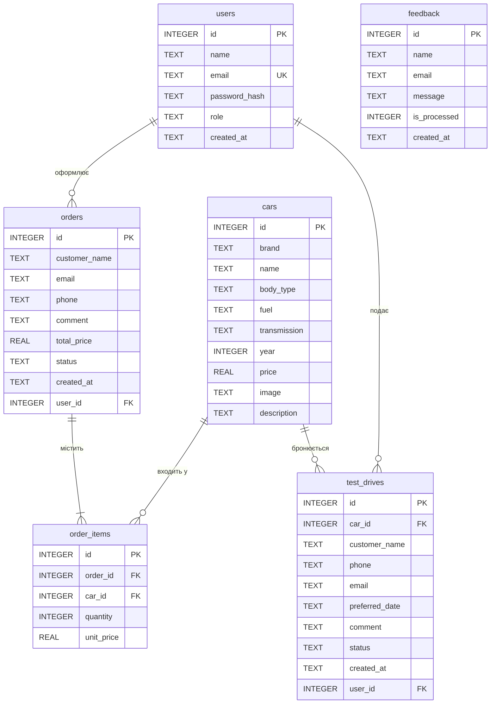

# MOTOREX — онлайн-автосалон

Навчальний вебзастосунок на Flask + SQLite (лабораторна робота №4).
Команда ІПЗ-22: Хомич Максим, Жук Діана, Сієнко Володимир.

## Можливості

- каталог автомобілів із бази даних, **пошук і фільтри** (марка, кузов, пальне, коробка, ціна, сортування);
- кошик у сесії та оформлення замовлення (`orders` + `order_items`);
- форма зворотного зв'язку (`feedback`);
- **запис на тест-драйв** (`test_drives`, додаткова таблиця);
- **користувачі з ролями** «адміністратор» і «клієнт», особистий кабінет з історією замовлень (`users`);
- адмін-панель: відгуки, авто (CRUD), замовлення та їхні статуси, тест-драйви, користувачі.

## Запуск

```bash
# macOS / Linux
python3 -m venv .venv
source .venv/bin/activate
pip install -r requirements.txt
python3 seed_data.py      # створює db.sqlite і демонстраційні дані
python3 app.py            # http://127.0.0.1:5000
```

```powershell
# Windows PowerShell
python -m venv .venv
.venv\Scripts\Activate.ps1
pip install -r requirements.txt
python seed_data.py
python app.py
```

Демонстраційні облікові записи (лише для навчання):

| Роль | Email | Пароль |
|---|---|---|
| Адміністратор | admin@motorex.ua | admin123 |
| Клієнт | client@motorex.ua | client123 |

Почати з чистої бази: видалити файл `db.sqlite` і знову виконати `seed_data.py`.

Автоматичні тести: `python3 -m unittest -v` (Windows: `python -m unittest -v`).

## Структура проєкту

```
app.py              — створення застосунку, Blueprint-и, фільтри money і car_image
models.py           — схема БД і всі SQL-запити (CRUD)
init_db.py          — створення таблиць
seed_data.py        — демонстраційні дані
routes/
  feedback.py       — /contact (форма відгуку)
  shop.py           — /shop (пошук і фільтри), /cart, /checkout
  test_drive.py     — /test-drive/<id>
  auth.py           — /register, /login, /logout, /account
  admin.py          — /admin/... (тільки для ролі admin)
templates/          — Jinja-шаблони (admin/, auth/ — окремі розділи)
static/img/         — фото авто (джерела в CREDITS.md)
tests/test_app.py   — автоматичні тести
```

## Схема бази даних



Правила зв'язків:

- `order_items.order_id → orders.id` — **ON DELETE CASCADE** (видалили замовлення — зникли його позиції);
- `order_items.car_id → cars.id` — **ON DELETE RESTRICT** (не можна видалити авто, яке вже є в замовленні);
- `test_drives.car_id → cars.id` — **ON DELETE CASCADE**;
- `orders.user_id`, `test_drives.user_id → users.id` — **ON DELETE SET NULL** (історія лишається).

`orders` ↔ `cars` — зв'язок «багато-до-багатьох» через проміжну таблицю `order_items`.

## Безпека

- усі SQL-запити параметризовані (`?`), сортування — лише з білого списку;
- паролі зберігаються як хеш (`werkzeug.security`);
- дії, що змінюють дані, виконуються тільки POST-запитами; після POST — redirect (PRG);
- адмін-панель перевіряє роль у `before_request`; клієнт отримує 403;
- ціни для замовлення беруться з БД, а не з браузера.
