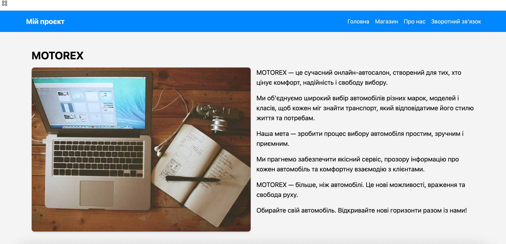
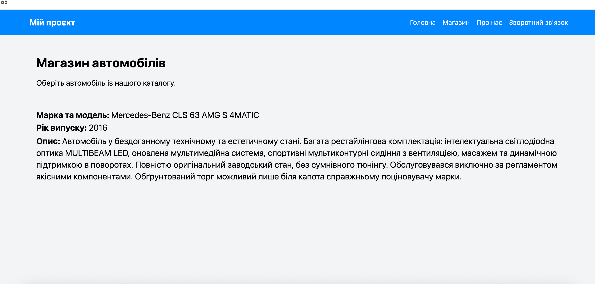
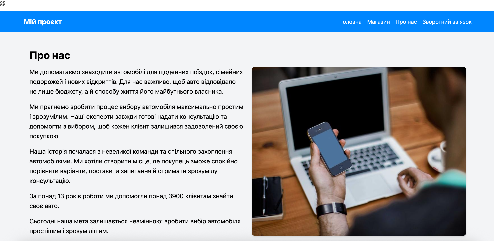
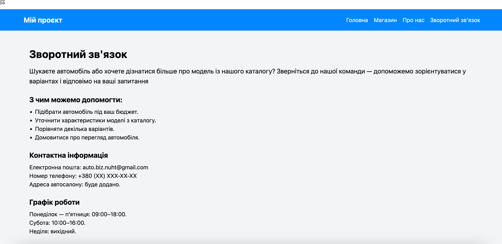
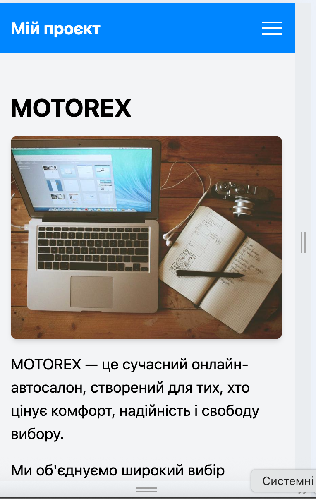
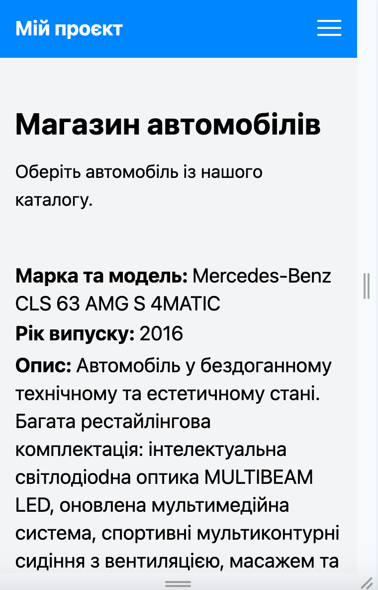
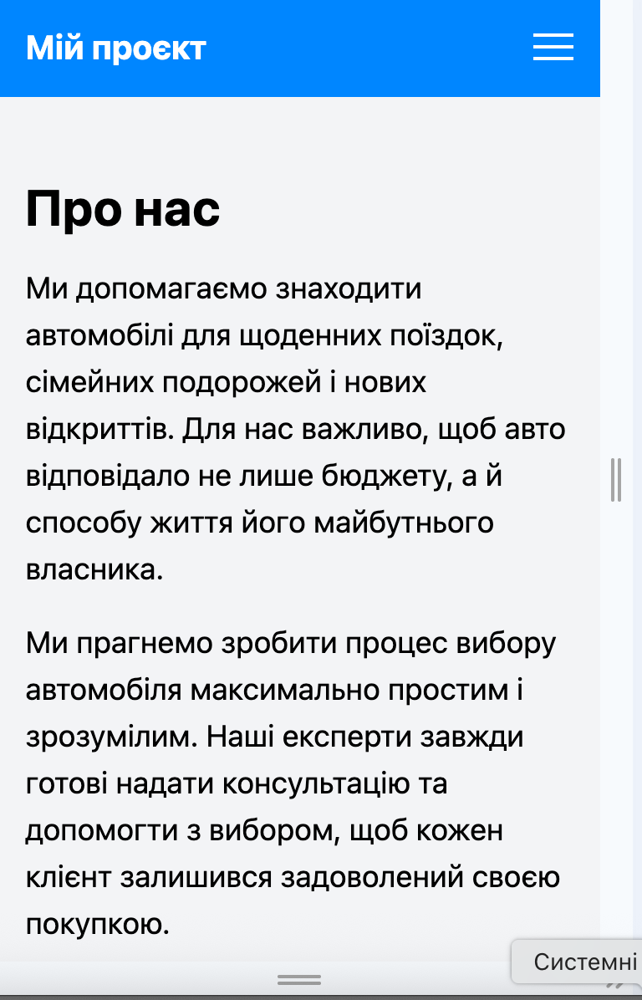
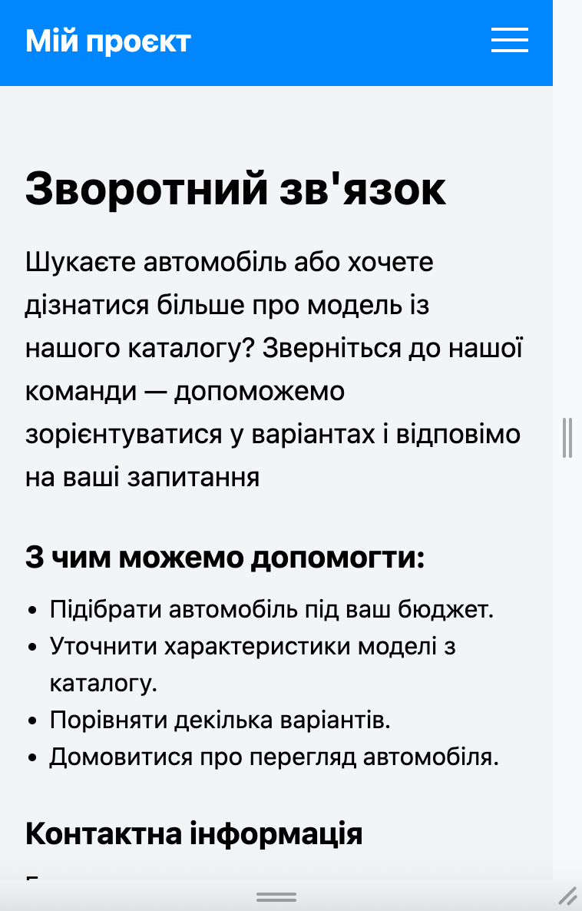

# Звіт до лабораторної роботи №3
## Розробка базового вебпроєкту

### 1. Загальні відомості

- ПІБ: Хомич Максим Віталійович
- Група: ІПЗ-22
- Склад команди: Хомич Максим Віталійович, Жук Діана Валеріївна, Сієнко Володимир Павлович.
- Предметна область: автомагазин MOTOREX.
- Репозиторій: https://github.com/Maksimka111222/auto_shop

### 2. Мета роботи

Навчитися створювати базовий вебзастосунок із використанням
Flask, працювати з HTML-шаблонами та об’єднувати зміни
учасників команди за допомогою Git.

### 3. Опис застосунку

Наша команда створила навчальний сайт автомагазину MOTOREX.
За основу ми взяли навчальний Flask-проєкт і змінили його
під обрану предметну область.

На сайті є чотири сторінки:

- «Головна» — коротка інформація про автомагазин.
- «Магазин» — приклад автомобіля з описом.
- «Про нас» — інформація про діяльність та історію магазину.
- «Зворотний зв’язок» — контакти, перелік послуг і графік роботи.

Для роботи застосунку використано Flask.
Сторінки створені за допомогою HTML і шаблонів Jinja,
а для оформлення використано Tailwind CSS.
Спільне меню розміщене у файлі base.html.

Історія та показники діяльності магазину є вигаданими
даними для навчального проєкту.

### 4. Особистий внесок

Я працював над сторінками «Про нас» і «Зворотний зв’язок».

У файлі about.html замінив початковий текст на опис
автомагазину, додав його історію та інформацію
про підхід до клієнтів.

У файлі contact.html додав запрошення звернутися,
список послуг, контактну інформацію та графік роботи.
Під час перевірки виправив помилки HTML:
прибрав неправильну вкладеність тегів, правильно
оформив заголовки, абзаци та список.

Також я підготував початковий спільний репозиторій
і брав участь в об’єднанні змін команди.
Діана працювала над головною сторінкою,
а Володимир — над сторінкою магазину.

Мій основний коміт:

[Наповнено сторінки Про нас і Зворотний зв'язок](https://github.com/Maksimka111222/auto_shop/commit/fc12256)

### 5. Результати роботи

Після завершення роботи ми об’єднали зміни
та перевірили сайт у своїх робочих копіях.
У всіх учасників застосунок запускається,
а сторінки відкриваються коректно.

Скріншоти сторінок у звичайному та мобільному вигляді:

### 6. Труднощі та їх вирішення

Під час створення контактної сторінки я спочатку
неправильно використовував деякі HTML-теги.
Наприклад, розміщував абзаци всередині заголовків
і використовував заголовки для звичайного тексту.
Після перевірки виправив структуру:
для назви сторінки залишив h1, для підрозділів — h2,
для тексту — p, а для переліку послуг — ul і li.

Також під час командної роботи виникла плутанина
зі старими та клонованими папками проєкту.
Ми перенесли готові файли учасників у правильні
робочі копії та створили окремі коміти.

Зміни об’єднували по черзі. Оскільки кожен працював
над своїми файлами, конфліктів під час злиття не виникло.

### 7. Висновки

Під час роботи я навчився редагувати сторінки
Flask-застосунку, використовувати HTML-теги
та працювати зі спільним базовим шаблоном.
Також закріпив навички створення комітів
і об’єднання змін у команді.
У результаті ми створили працездатний навчальний сайт
автомагазину з чотирма сторінками.