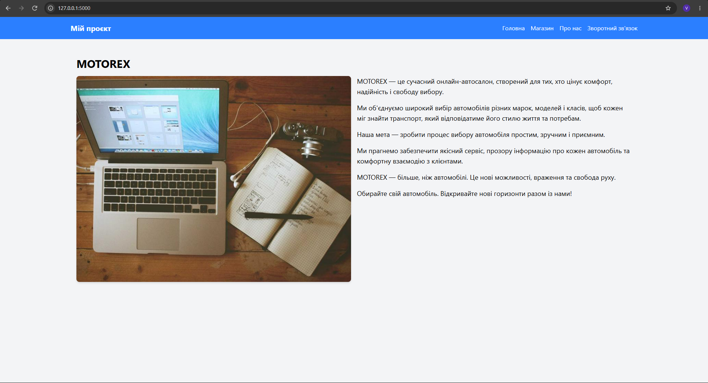
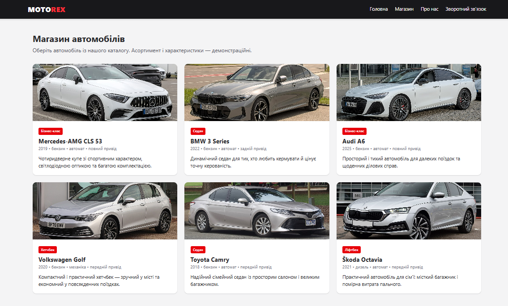
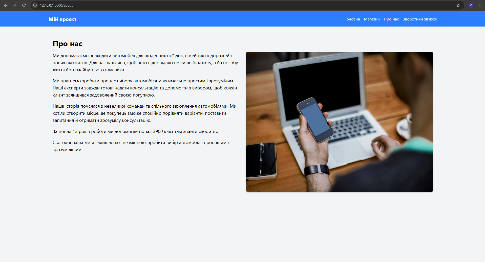
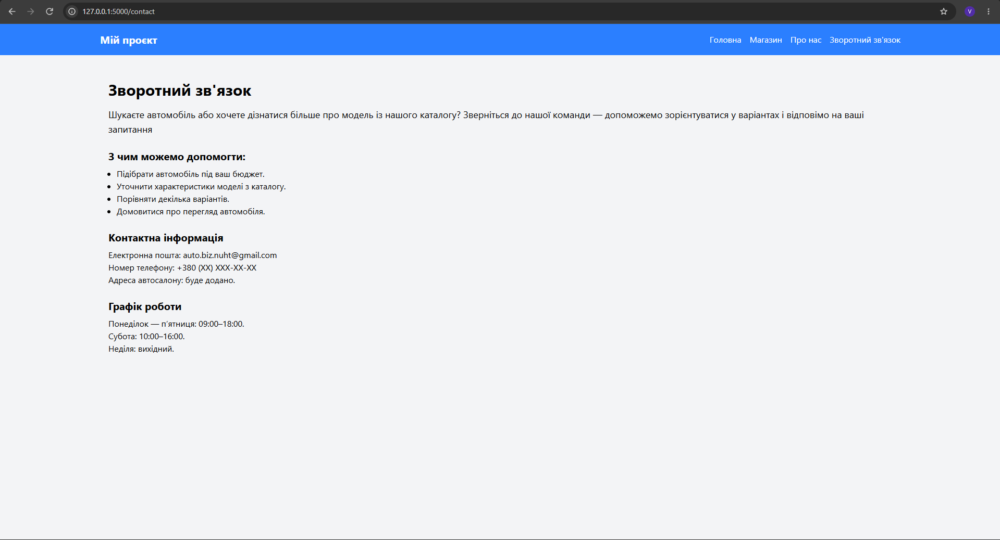
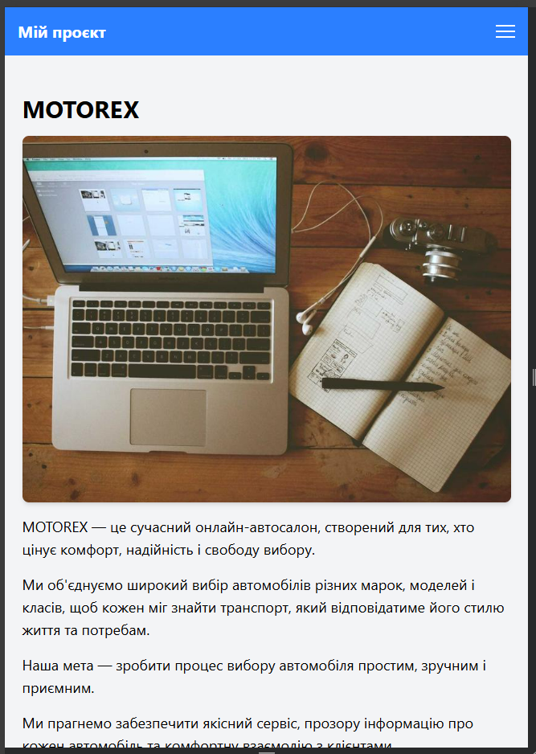
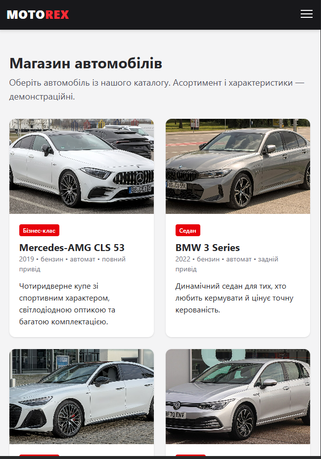
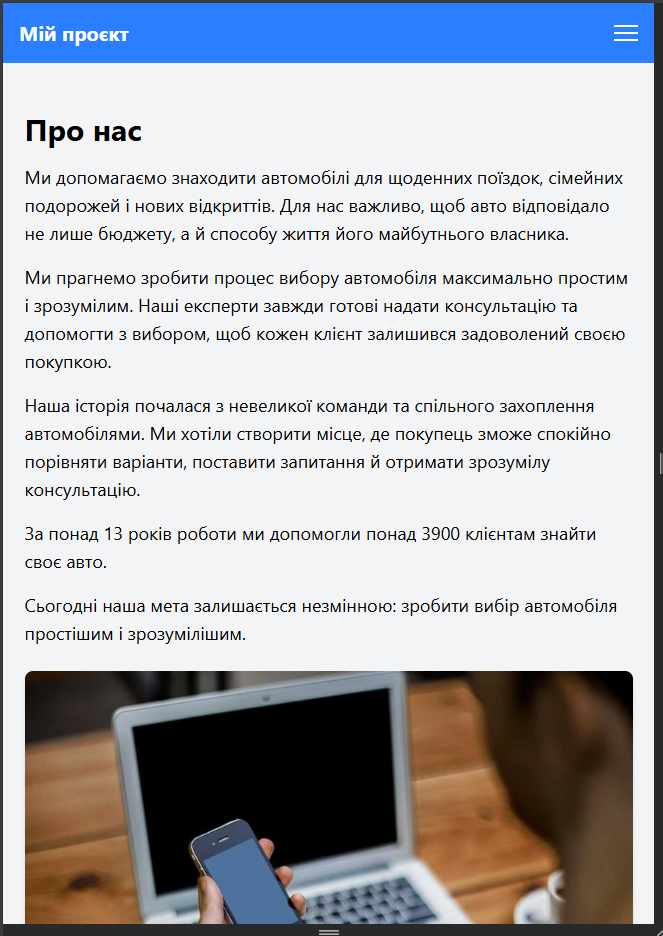
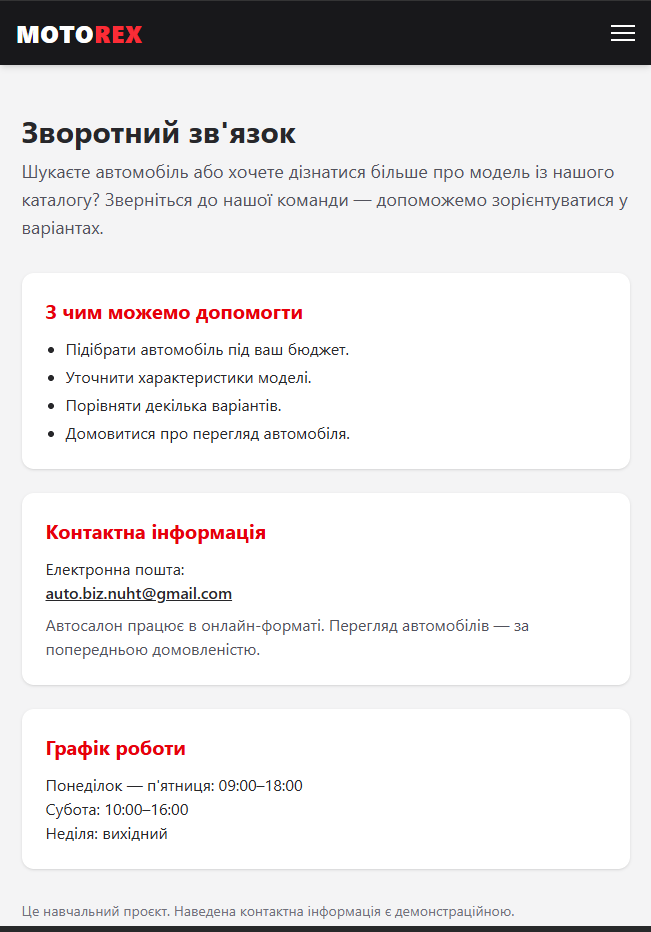

# Звіт до лабораторної роботи №3
## Розробка базового вебпроєкту

### 1. Загальні відомості

- ПІБ: Сієнко Володимир Павлович
- Група: ІПЗ-22
- Склад команди: Жук Діана Валеріївна , Хомич Максим Віталійович, Сієнко Володимир Павлович
- Предметна область: автомагазин MOTOREX.

### 2. Мета роботи

Навчитися створювати базовий вебзастосунок із використанням
Flask, працювати з HTML-шаблонами та об’єднувати зміни
учасників команди за допомогою Git.

### 3. Опис застосунку

Наша команда створила навчальний сайт автомагазину MOTOREX.
За основу ми взяли навчальний Flask-проєкт і змінили його
під обрану предметну область.

На сайті є чотири сторінки:

- «Головна» — банер із фото, коротка інформація про автомагазин,
  його переваги та популярні моделі з каталогу.
- «Магазин» — каталог із шести автомобілів у вигляді карток
  з фото, класом, роком, типом пального, коробкою передач та описом.
- «Про нас» — інформація про діяльність та історію магазину,
  його мету та підхід до клієнтів.
- «Зворотний зв’язок» — контакти, перелік послуг і графік роботи.

Для роботи застосунку використано Flask.
Сторінки створені за допомогою HTML і шаблонів Jinja,
а для оформлення використано Tailwind CSS.
Спільне меню, шапка та підвал розміщені у файлі base.html.
Фотографії автомобілів зберігаються в папці static/img
і підключаються через url_for('static', ...).

Після першої версії ми оновили оформлення сайту:
додали єдиний стиль (темна шапка й червоний акцент),
фотографії, картки та адаптивні сітки, які на телефоні
перебудовуються в одну колонку.
Як приклад оформлення використовували варіант,
запропонований ШІ-асистентом; свої частини кожен переносив
у проєкт, адаптував і перевіряв самостійно.

Інформація про магазин і характеристики автомобілів
використовуються як навчальне наповнення сайту.
Фото взято з Wikimedia Commons, джерела вказані у файлі
static/img/CREDITS.md.

### 4. Особистий внесок

Я працював над сторінкою «Магазин» у файлі shop.html.

На сторінці залишив заголовок магазину та запрошення
обрати автомобіль із каталогу. Додав приклад автомобіля
Mercedes-Benz CLS 63 AMG S 4MATIC, указав рік випуску
та написав короткий опис.

Для структурування інформації використав заголовки
й абзаци.

Під час оновлення дизайну замість одного опису
зробив каталог із шести автомобілів: Mercedes-AMG CLS 53,
BMW 3 Series, Audi A6, Volkswagen Golf, Toyota Camry
та Škoda Octavia. Кожен автомобіль оформив карткою
з фото, позначкою класу, роком, типом пального,
коробкою передач і коротким описом.
Картки розмістив в адаптивній сітці: на телефоні —
одна колонка, на планшеті — дві, на широкому екрані — три.
Перший автомобіль замінив на Mercedes-AMG CLS 53,
щоб назва відповідала фото. Зберіг наслідування базового шаблону base.html,
щоб сторінка використовувала спільне меню сайту.

Свої зміни зберіг окремими комітами і взяв участь
в об’єднанні роботи команди.
Максим працював над сторінками «Про нас»
і «Зворотний зв’язок», а Діана — над головною

Посилання на особисті коміти:
- https://github.com/Maksimka111222/auto_shop/commit/8c6fbd3
- https://github.com/Maksimka111222/auto_shop/commit/6d8c6c6

### 5. Результати роботи

Після завершення роботи ми об’єднали зміни
та перевірили сайт у своїх робочих копіях.
Застосунок запускається, сторінка магазину
відкривається через меню, а картки автомобілів
із фото відображаються коректно на широкому
та вузькому екранах.

Скріншоти сторінок у звичайному та мобільному вигляді:

### 6. Труднощі та їх вирішення

Під час роботи виникла плутанина між старою папкою
проєкту та папкою, клонованою з репозиторію.
У звичайній папці команди Git не знаходили репозиторій.
Для вирішення готовий файл сторінки переніс
до своєї клонованої копії проєкту.

Також потрібно було зберегти лише власні зміни,
не додаючи сторонні файли. Тому перед комітом
перевірив стан Git та додав саме templates/shop.html.

Під час створення каталогу потрібно було, щоб
усі картки мали однакову висоту фото. Для цього
використав класи h-48 та object-cover: фото обрізається
до однакового розміру без спотворення пропорцій.

Зміни команди об’єднували по черзі.
Оскільки учасники працювали над різними файлами,
конфліктів під час злиття не виникло.

### 7. Висновки

Під час роботи я навчився наповнювати HTML-сторінку,
використовувати заголовки й абзаци, робити адаптивну
сітку карток та працювати
зі спільним шаблоном Flask-застосунку.
Також закріпив навички створення комітів
і отримання змін інших учасників через Git.
У результаті команда створила працездатний
навчальний сайт автомагазину з чотирма сторінками
і каталогом автомобілів.