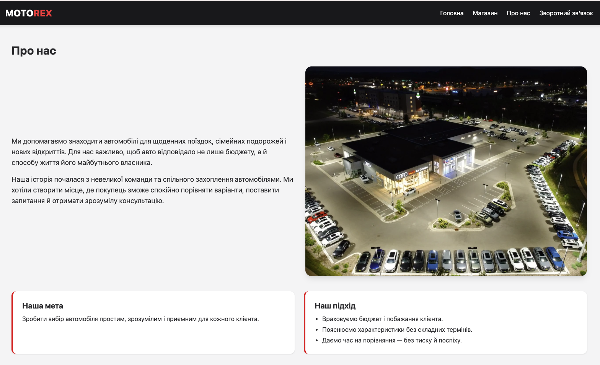
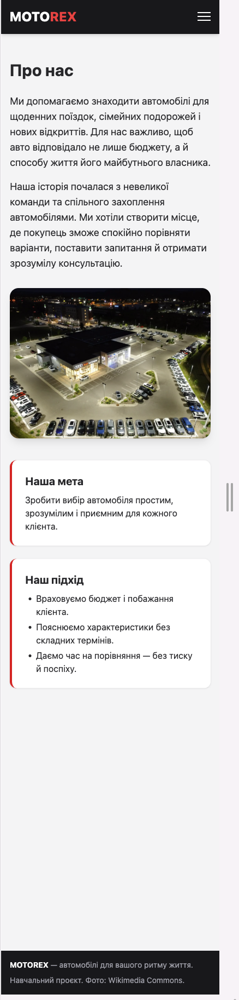
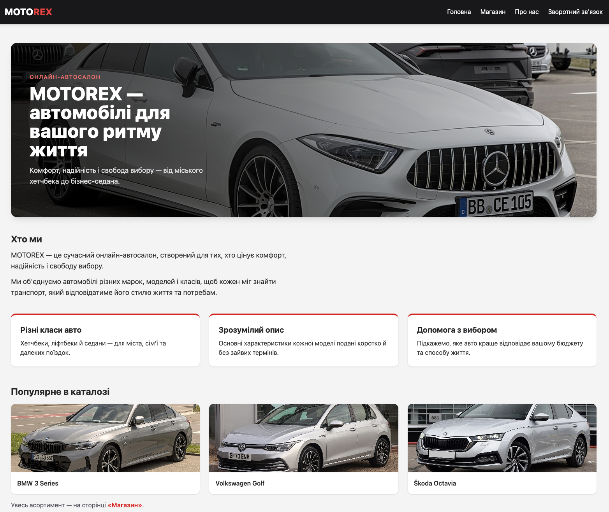
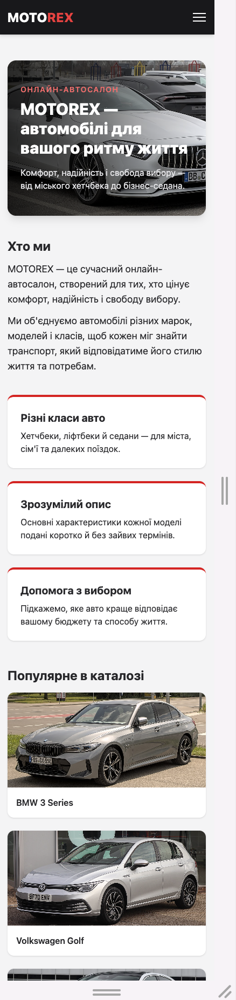
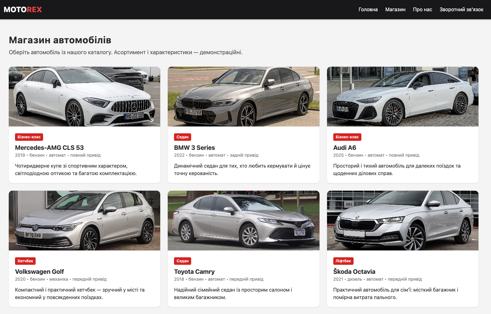
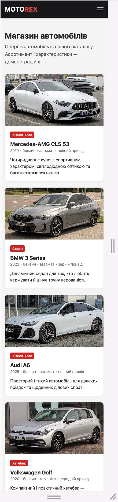
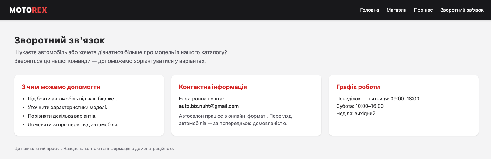
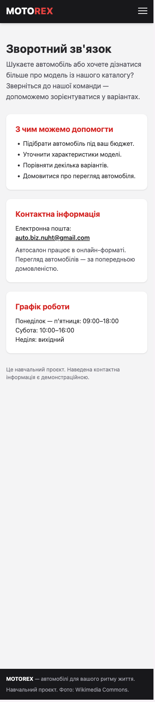

# Звіт до лабораторної роботи №3
## Розробка базового вебпроєкту

### 1. Загальні відомості

- ПІБ: Жук Діана Валеріївна
- Група: ІПЗ-22
- Склад команди: Хомич Максим Віталійович, Жук Діана Валеріївна, Сієнко Володимир Павлович
- Предметна область: автомагазин MOTOREX.
- Репозиторій: https://github.com/Maksimka111222/auto_shop

### 2. Мета роботи

Навчитися створювати базовий вебзастосунок із використанням
Flask, працювати з HTML-шаблонами та об’єднувати зміни
учасників команди за допомогою Git.

### 3. Опис застосунку

Наша команда створила навчальний сайт автомагазину MOTOREX.
За основу ми взяли навчальний Flask-проєкт і змінили його
під обрану предметну область.

На сайті є чотири сторінки:

- «Головна» — банер із фото, коротка інформація про автомагазин,
  його переваги та популярні моделі з каталогу.
- «Магазин» — каталог із шести автомобілів у вигляді карток
  з фото, класом, роком, типом пального, коробкою передач та описом.
- «Про нас» — інформація про діяльність та історію магазину,
  його мету та підхід до клієнтів.
- «Зворотний зв’язок» — контакти, перелік послуг і графік роботи.

Для роботи застосунку використано Flask.
Сторінки створені за допомогою HTML і шаблонів Jinja,
а для оформлення використано Tailwind CSS.
Спільне меню, шапка та підвал розміщені у файлі base.html.
Фотографії автомобілів зберігаються в папці static/img
і підключаються через url_for('static', ...).

Після першої версії ми оновили оформлення сайту:
додали єдиний стиль (темна шапка й червоний акцент),
фотографії, картки та адаптивні сітки, які на телефоні
перебудовуються в одну колонку.
Як приклад оформлення використовували варіант,
запропонований ШІ-асистентом; свої частини кожен переносив
у проєкт, адаптував і перевіряв самостійно.

Історія магазину та характеристики автомобілів у каталозі
є демонстраційними даними для навчального проєкту.
Фото взято з Wikimedia Commons, джерела вказані у файлі
static/img/CREDITS.md.

### 4. Особистий внесок

Я працювала над головною сторінкою у файлі home.html.

Замінила початковий навчальний заголовок на назву MOTOREX
та написала текст про автомагазин, його мету й підхід
до обслуговування клієнтів.

Розділила текст на абзаци та зберегла адаптивну сітку
із зображенням і текстовим блоком. Під час перевірки
прибрала зайві закривальні теги та правильно розмістила
весь текст усередині потрібного блоку.

Під час оновлення дизайну переробила головну сторінку:
додала банер із фото автомобіля та заголовком поверх нього,
блок «Хто ми», три картки з перевагами магазину
та розділ «Популярне в каталозі» з трьома моделями
і посиланням на сторінку «Магазин».
Картки переваг на широкому екрані стоять у три колонки,
а на телефоні — одна під одною.

Свої зміни зберегла окремими комітами і взяла участь
в об’єднанні роботи команди.
Максим працював над сторінками «Про нас»
і «Зворотний зв’язок», а Володимир — над магазином.

Мої основні коміти:

- [Наповнено головну сторінку MOTOREX](https://github.com/Maksimka111222/auto_shop/commit/cba69b4)
- [Оновлено вигляд головної сторінки](https://github.com/Maksimka111222/auto_shop/commit/00f2149)

### 5. Результати роботи

Після завершення роботи ми об’єднали зміни
та перевірили сайт у своїх робочих копіях.
Застосунок запускається, на головній сторінці
відображаються банер із назвою MOTOREX, фото автомобілів,
картки переваг і підготовлений текст.

Скріншоти сторінок у звичайному та мобільному вигляді:

### 6. Труднощі та їх вирішення

Під час редагування головної сторінки у файлі
залишилися зайві закривальні теги абзаців і блоку div.
Після перевірки я прибрала їх та виправила
розміщення тексту в сітці.

Також виникла плутанина між старою папкою проєкту
та клонованим репозиторієм. Готовий файл перенесла
до правильної робочої копії, після чого змогла
створити власний коміт.

Під час надсилання змін GitHub не прийняв
звичайний пароль облікового запису.
Для вирішення налаштувала автентифікацію
за допомогою особистого токена доступу.

Під час оновлення головної старе фото підключалося
зі стороннього сайту. Я замінила його на фото
з папки static/img, підключене через url_for.

Зміни команди об’єднували по черзі.
Конфліктів під час злиття не виникло.

### 7. Висновки

Під час роботи я навчилася редагувати головну сторінку
Flask-застосунку, структурувати текст і перевіряти
правильність HTML-тегів, а також робити
адаптивні блоки та підключати фото з папки static.
Також закріпила навички створення комітів
і роботи зі спільним репозиторієм.
У результаті команда створила працездатний навчальний
сайт автомагазину з чотирма сторінками.