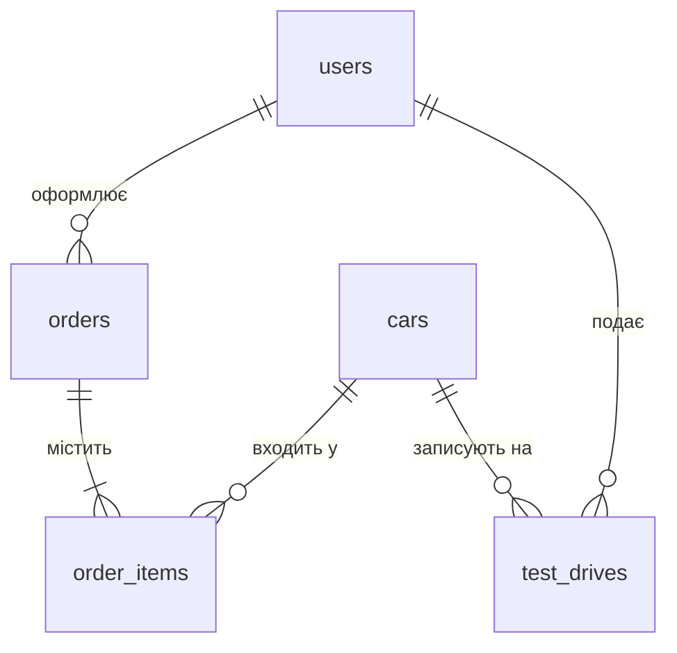
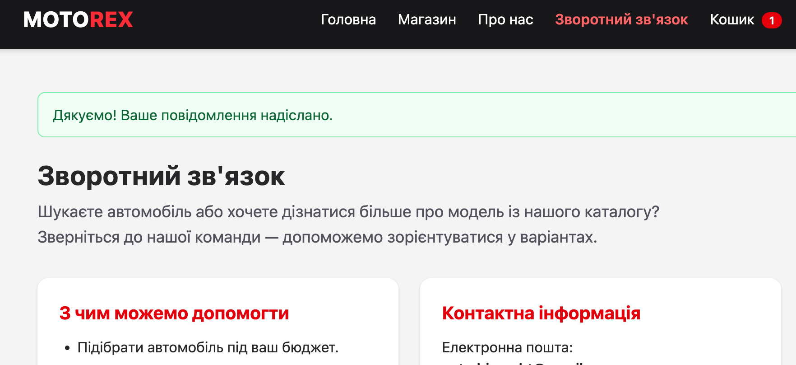
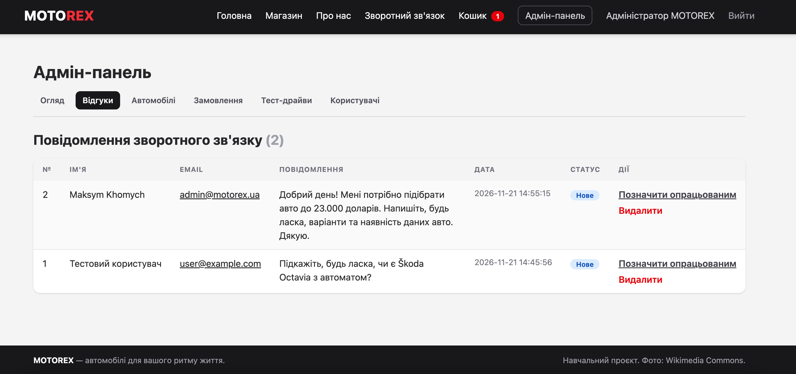
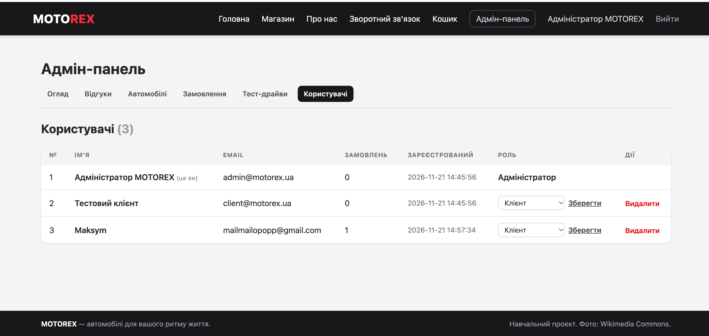
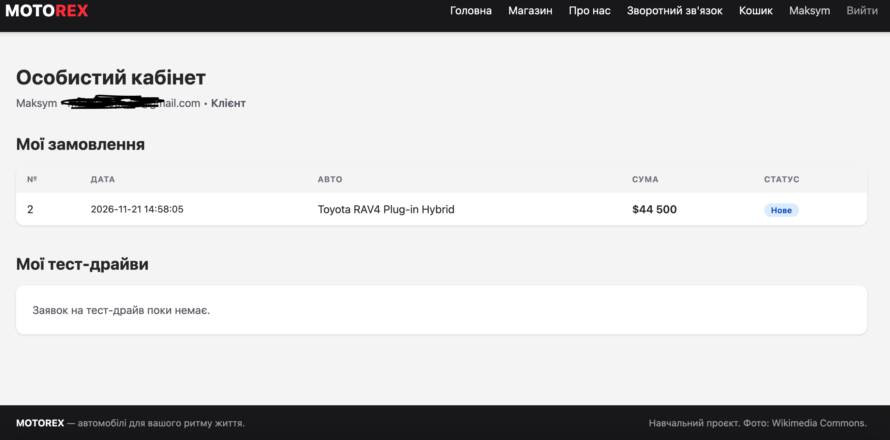

# Звіт до лабораторної роботи №4
## Реалізація бази даних для вебпроєкту

### 1. Загальні відомості

- ПІБ: Хомич Максим Віталійович
- Група: ІПЗ-22
- Склад команди: Хомич Максим Віталійович, Жук Діана Валеріївна, Сієнко Володимир Павлович.
- Тема проєкту: автомагазин MOTOREX.
- Репозиторій: https://github.com/Maksimka111222/auto_shop

### 2. Мета роботи

Навчитися проєктувати реляційну базу даних, підключати SQLite до
Flask-застосунку та реалізовувати CRUD-операції і адміністративну
частину вебпроєкту.

### 3. Опис застосунку і схема БД

До сайту MOTOREX з ЛР3 ми додали базу даних SQLite (`db.sqlite`).
Структура БД описана у файлі `models.py`, тестові дані створює
скрипт `seed_data.py`. Користувач може залишити відгук, вибрати
авто в каталозі, оформити замовлення і записатися на тест-драйв,
а адміністратор керує всім цим у панелі `/admin`.

Таблиці бази даних:

| Таблиця | Призначення | Зв'язки |
|---|---|---|
| `feedback` | відгуки з форми «Зворотний зв'язок» | — |
| `cars` | автомобілі каталогу (товари) | — |
| `orders` | замовлення, статус, сума | `user_id → users.id` |
| `order_items` | позиції замовлення (кількість, ціна) | `order_id → orders.id`, `car_id → cars.id` |
| `test_drives` | заявки на тест-драйв (рівень 2) | `car_id → cars.id`, `user_id → users.id` |
| `users` | користувачі з ролями client/admin | — |

Зв'язок «багато-до-багатьох» між замовленнями й авто реалізовано
через проміжну таблицю `order_items`. Статуси замовлення: «Нове»,
«В обробці», «Підтверджене», «Виконане», «Скасоване».

Повна схема з усіма полями — у [README.md](../README.md).

Додаткові можливості (рівень 3): пошук і фільтрація каталогу
(марка, кузов, пальне, коробка, ціна, сортування) та реєстрація
й вхід користувачів з ролями і особистим кабінетом. Також
додано автоматичні тести (`tests/test_app.py`).

### 4. Особистий внесок

Я виконав перший і останній етапи роботи.

На першому етапі створив модуль `models.py` з підключенням до
SQLite (`get_db()` / `close_db()` через `g` і `teardown_appcontext`),
таблицю `feedback` і функції CRUD для неї. Перевів форму на сторінці
«Зворотний зв'язок» на збереження в БД з перевіркою полів, а також
створив адмін-сторінку відгуків з переглядом, позначкою
«оброблено» і видаленням. Додав `db.sqlite` у `.gitignore`.

На четвертому етапі додав таблицю `users` (паролі зберігаються
у вигляді хешу), реєстрацію, вхід і вихід, ролі client/admin,
захист адмін-панелі (403 для клієнта), особистий кабінет з історією
замовлень і сторінку керування користувачами. Для існуючих баз
написав міграцію, яка додає `orders.user_id`. Також підготував
README зі схемою БД і автоматичні тести.

Володимир реалізував каталог, кошик, замовлення і фільтри,
Діана — адмін-панель для авто і замовлень та тест-драйви.

Мої коміти:

- [Додано db.sqlite і кеш Python у .gitignore](https://github.com/Maksimka111222/auto_shop/commit/9a4e593)
- [Додано базу SQLite, форму відгуків і адмін-панель для відгуків](https://github.com/Maksimka111222/auto_shop/commit/a5e43b9)
- [Додано користувачів з ролями, вхід, реєстрацію та історію замовлень](https://github.com/Maksimka111222/auto_shop/commit/7698591)
- [Додано README зі схемою БД і автоматичні тести](https://github.com/Maksimka111222/auto_shop/commit/47365c2)

### 5. Результати

Відгук збережено в базі даних.

Відгуки в адмін-панелі.

Керування користувачами.

Особистий кабінет з історією замовлень.

### 6. Труднощі

Спочатку адмін-сторінка відгуків відкривалася будь-кому, хто знав адресу `/admin`. Я додав перевірку ролі в `before_request` для всього blueprint. Тепер гість потрапляє на сторінку входу, а клієнт отримує помилку 403.

У вже створеній базі не було колонки `orders.user_id`, бо `CREATE TABLE IF NOT EXISTS` не змінює існуючі таблиці. Через це код падав на старих базах. Я написав невелику міграцію: вона перевіряє `PRAGMA table_info` і, якщо потрібно, виконує `ALTER TABLE`.

Також довелося перейти від збереження пароля до збереження його хешу. Для цього треба було змінити і реєстрацію, і вхід, і тестові дані в `seed_data.py`, інакше вхід адміністратора не працював.

Через `db.sqlite` в `.gitignore` у кожного з нас була власна база. Після `git pull` її потрібно було перестворювати через `seed_data.py`.

### 7. Висновки

Я навчився підключати SQLite до Flask, правильно відкривати та
закривати з'єднання і виконувати параметризовані запити. Також
зрозумів, як зберігати паролі через хеш і обмежувати доступ
до адмін-панелі за роллю користувача.

Як приклад оформлення використовували варіант, запропонований
ШІ-асистентом; свої частини кожен переносив у проєкт, адаптував
і перевіряв самостійно.
