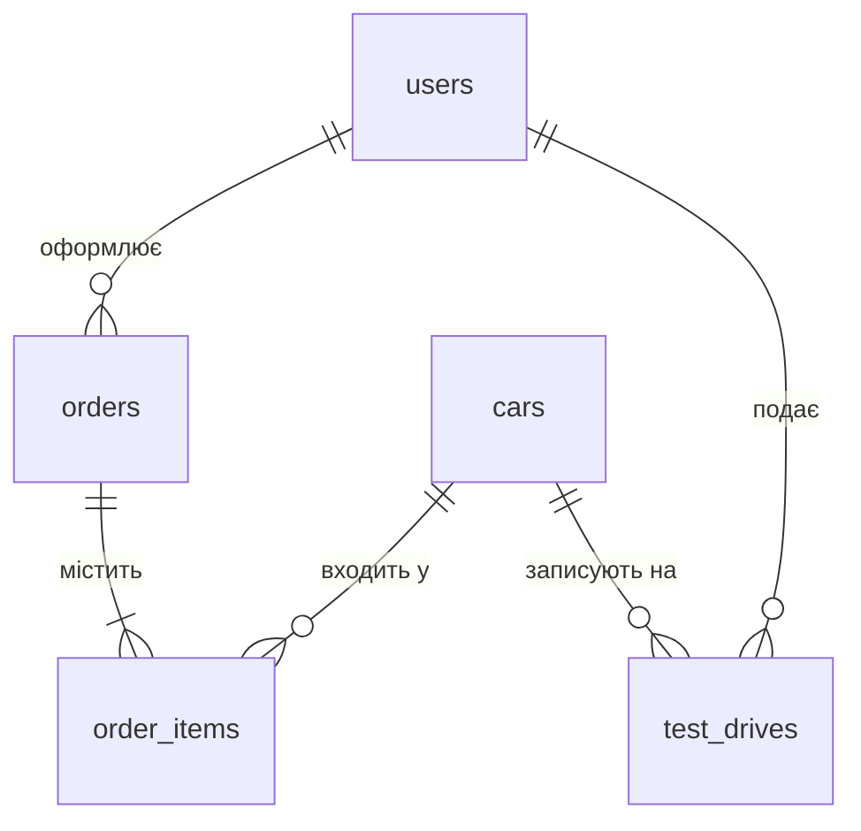
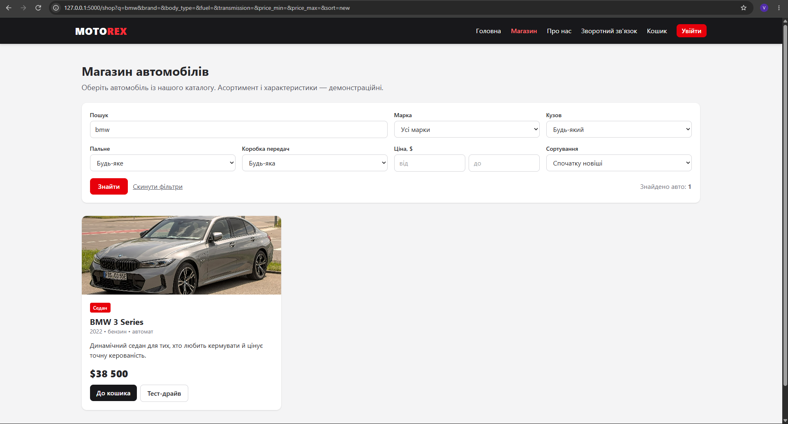
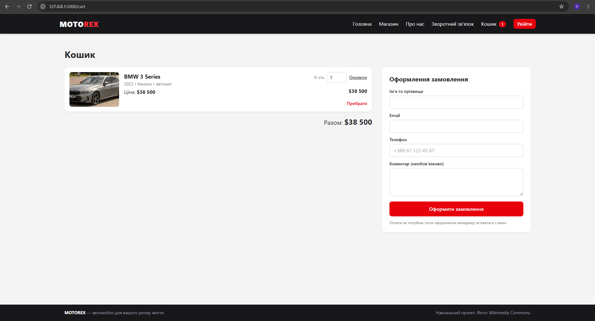
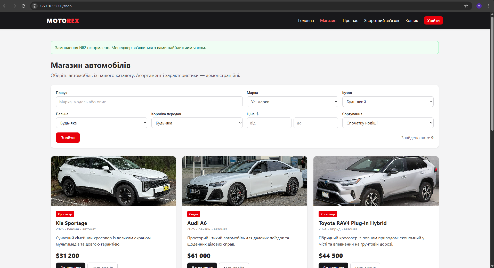

# Звіт до лабораторної роботи №4
## Реалізація бази даних для вебпроєкту

### 1. Загальні відомості

- ПІБ: Сієнко Володимир Павлович
- Група: ІПЗ-22
- Склад команди: Хомич Максим Віталійович, Жук Діана Валеріївна, Сієнко Володимир Павлович.
- Тема проєкту: автомагазин MOTOREX.
- Репозиторій: https://github.com/Maksimka111222/auto_shop

### 2. Мета роботи

Навчитися проєктувати реляційну базу даних, підключати SQLite до
Flask-застосунку та реалізовувати CRUD-операції і адміністративну
частину вебпроєкту.

### 3. Опис застосунку і схема БД

До сайту MOTOREX з ЛР3 ми додали базу даних SQLite (`db.sqlite`).
Структура БД описана у файлі `models.py`, тестові дані створює
скрипт `seed_data.py`. Користувач може залишити відгук, вибрати
авто в каталозі, оформити замовлення і записатися на тест-драйв,
а адміністратор керує всім цим у панелі `/admin`.

Таблиці бази даних:

| Таблиця | Призначення | Зв'язки |
|---|---|---|
| `feedback` | відгуки з форми «Зворотний зв'язок» | — |
| `cars` | автомобілі каталогу (товари) | — |
| `orders` | замовлення, статус, сума | `user_id → users.id` |
| `order_items` | позиції замовлення (кількість, ціна) | `order_id → orders.id`, `car_id → cars.id` |
| `test_drives` | заявки на тест-драйв (рівень 2) | `car_id → cars.id`, `user_id → users.id` |
| `users` | користувачі з ролями client/admin | — |

Зв'язок «багато-до-багатьох» між замовленнями й авто реалізовано
через проміжну таблицю `order_items`. Статуси замовлення: «Нове»,
«В обробці», «Підтверджене», «Виконане», «Скасоване».

Повна схема з усіма полями — у [README.md](../README.md).

Додаткові можливості (рівень 3): пошук і фільтрація каталогу
(марка, кузов, пальне, коробка, ціна, сортування) та реєстрація
й вхід користувачів з ролями і особистим кабінетом. Також
додано автоматичні тести (`tests/test_app.py`).

### 4. Особистий внесок

Я виконав другий етап роботи — магазин.

Створив таблиці `cars`, `orders` і `order_items` та функції для
роботи з ними. Переробив сторінку «Магазин»: тепер автомобілі
беруться з бази даних. Додав кошик (зберігається в сесії),
зміну кількості, видалення позиції і оформлення замовлення
з перевіркою імені, email і телефону. Замовлення і його позиції
записуються однією транзакцією, а ціна фіксується на момент покупки.

Також реалізував додаткову можливість — пошук і фільтри каталогу
за маркою, типом кузова, пальним, коробкою, ціною та сортування.
Сортування береться лише з білого списку, а всі значення
передаються через параметри `?`, тому SQL-ін'єкція неможлива.
Додав фото трьох нових авто з Wikimedia Commons (з вказанням
авторів у static/img/CREDITS.md) і тестові дані в `seed_data.py`.

Мої коміти:

- [Додано фото Tesla Model 3, Toyota RAV4 і Kia Sportage](https://github.com/Maksimka111222/auto_shop/commit/14df3ce)
- [Додано таблиці авто і замовлень, кошик, пошук і фільтри каталогу](https://github.com/Maksimka111222/auto_shop/commit/1237e53)

### 5. Результати

Каталог з увімкненим фільтром.

Кошик і форма оформлення замовлення.

Замовлення успішно оформлено.

### 6. Труднощі

Найважче було з фільтрами: потрібно було зібрати SQL-запит
лише з тих умов, які користувач вибрав. Ми додаємо умови
в список і значення в окремий список параметрів, а не вставляємо
їх у текст запиту.

Також були труднощі з налаштуванням середовища. Windows розпакував
архів із вкладеною папкою MOTOREX_lab4, тому шлях до файлів свого етапу
довелося вказувати з подвійною вкладеністю. Українські назви файлів в архіві
відображалися нечитабельними символами. Git показував попередження про заміну
LF на CRLF, але на роботу проєкту це не вплинуло. Після оновлення коду
потрібно було видаляти стару базу db.sqlite і створювати її заново
командою seed_data.py, бо в старій не було таблиці cars.

### 7. Висновки

Я зрозумів, як реалізувати зв'язок «багато-до-багатьох» через
проміжну таблицю і як працюють транзакції під час оформлення
замовлення. Також навчився безпечно будувати запити з фільтрами
через параметри.

Як приклад оформлення використовували варіант, запропонований
ШІ-асистентом; свої частини кожен переносив у проєкт, адаптував
і перевіряв самостійно.
