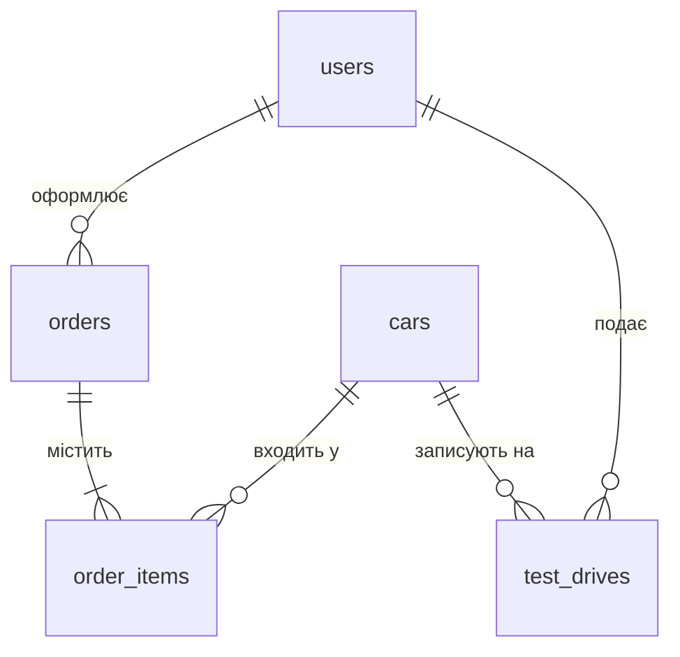
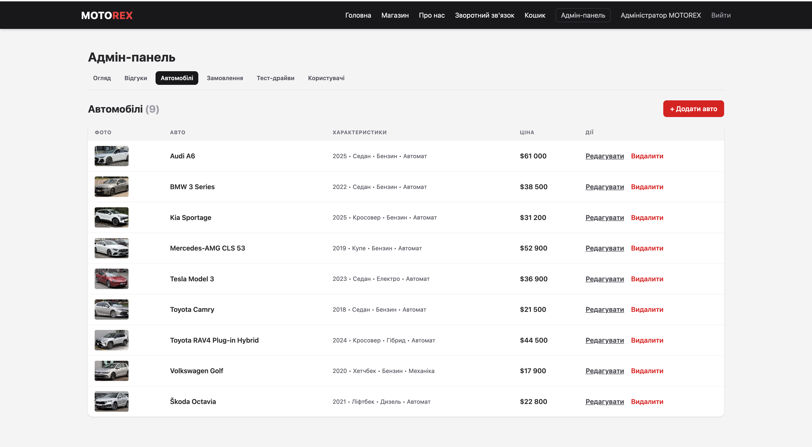
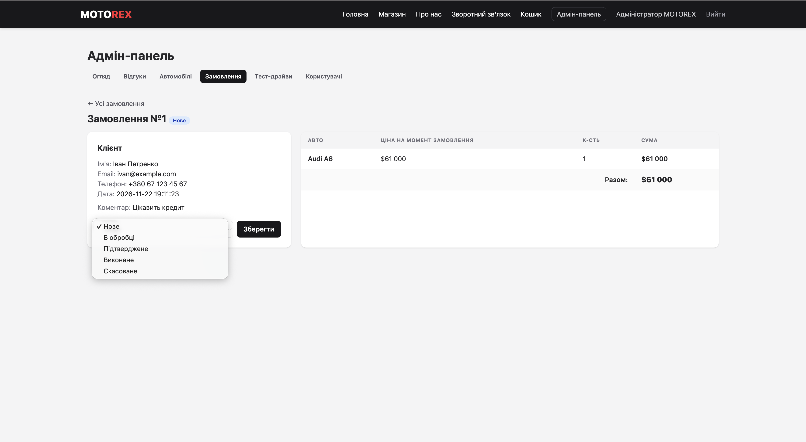
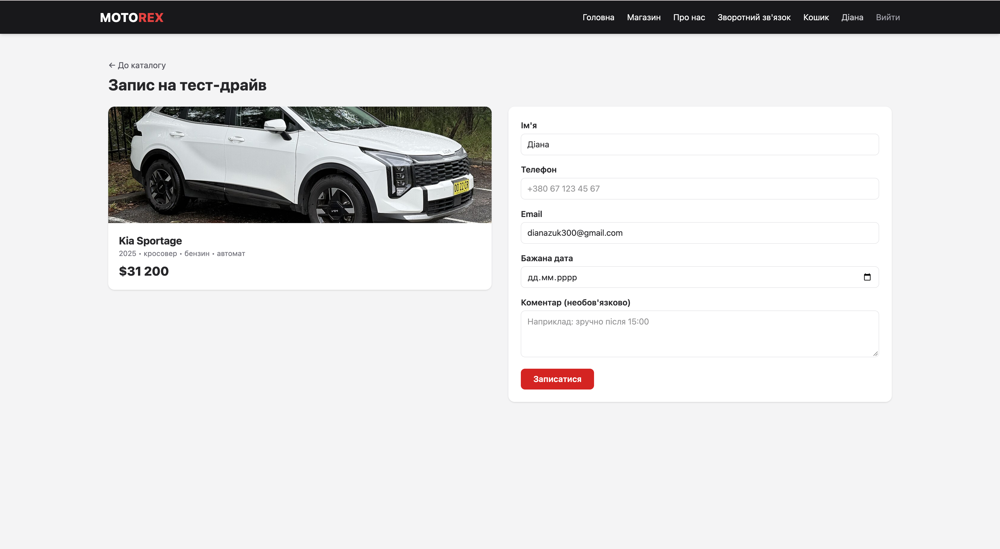
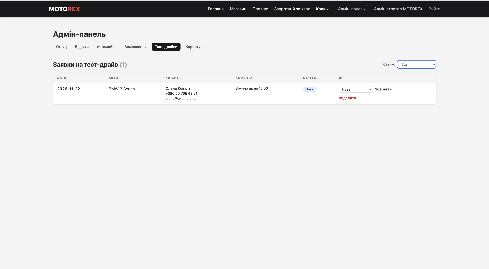

# Звіт до лабораторної роботи №4
## Реалізація бази даних для вебпроєкту

### 1. Загальні відомості

- ПІБ: Жук Діана Валеріївна
- Група: ІПЗ-22
- Склад команди: Хомич Максим Віталійович, Жук Діана Валеріївна, Сієнко Володимир Павлович.
- Тема проєкту: автомагазин MOTOREX.
- Репозиторій: https://github.com/Maksimka111222/auto_shop

### 2. Мета роботи

Навчитися проєктувати реляційну базу даних, підключати SQLite до
Flask-застосунку та реалізовувати CRUD-операції і адміністративну
частину вебпроєкту.

### 3. Опис застосунку і схема БД

До сайту MOTOREX з ЛР3 ми додали базу даних SQLite (`db.sqlite`).
Структура БД описана у файлі `models.py`, тестові дані створює
скрипт `seed_data.py`. Користувач може залишити відгук, вибрати
авто в каталозі, оформити замовлення і записатися на тест-драйв,
а адміністратор керує всім цим у панелі `/admin`.

Таблиці бази даних:

| Таблиця | Призначення | Зв'язки |
|---|---|---|
| `feedback` | відгуки з форми «Зворотний зв'язок» | — |
| `cars` | автомобілі каталогу (товари) | — |
| `orders` | замовлення, статус, сума | `user_id → users.id` |
| `order_items` | позиції замовлення (кількість, ціна) | `order_id → orders.id`, `car_id → cars.id` |
| `test_drives` | заявки на тест-драйв (рівень 2) | `car_id → cars.id`, `user_id → users.id` |
| `users` | користувачі з ролями client/admin | — |

Зв'язок «багато-до-багатьох» між замовленнями й авто реалізовано
через проміжну таблицю `order_items`. Статуси замовлення: «Нове»,
«В обробці», «Підтверджене», «Виконане», «Скасоване».

Повна схема з усіма полями — у [README.md](../README.md).

Додаткові можливості (рівень 3): пошук і фільтрація каталогу
(марка, кузов, пальне, коробка, ціна, сортування) та реєстрація
й вхід користувачів з ролями і особистим кабінетом. Також
додано автоматичні тести (`tests/test_app.py`).

### 4. Особистий внесок

Я виконала третій етап роботи — адміністративну частину і тест-драйви.

В адмін-панелі зробила головну сторінку зі статистикою, керування
автомобілями (додавання, редагування, видалення), список
замовлень, сторінку деталей замовлення з позиціями та зміну
статусу замовлення. Авто, яке вже є в замовленні, не можна
видалити — адміністратор бачить зрозуміле повідомлення.

Для рівня 2 додала таблицю `test_drives`, пов'язану з `cars`,
форму запису на тест-драйв (дата не може бути в минулому) та
сторінку в адмін-панелі для зміни статусу і видалення заявок.
На головній сторінці тепер показуються останні авто з бази даних.

Мої коміти:

- [Розширено адмін-панель: керування авто, замовленнями та їх статусами](https://github.com/Maksimka111222/auto_shop/commit/9eb18d7)
- [Додано таблицю тест-драйвів, форму запису і популярні авто з БД на головній](https://github.com/Maksimka111222/auto_shop/commit/XXXXXXX)

### 5. Результати

Керування автомобілями в адмін-панелі.

Деталі замовлення і зміна статусу.

Форма запису на тест-драйв.

Заявки на тест-драйв в адмін-панелі.

### 6. Труднощі

Складність виникла з видаленням автомобіля, який уже є
в замовленні. Через зовнішній ключ з `ON DELETE RESTRICT`
база не дозволяє таке видалення, і спочатку це викликало помилку.
Ми перехоплюємо `sqlite3.IntegrityError` і показуємо повідомлення.

Також з'ясувалося, що в SQLite зовнішні ключі працюють лише
після `PRAGMA foreign_keys = ON`.

### 7. Висновки

Я навчилася створювати адміністративну частину з CRUD-операціями
і пов'язувати таблиці зовнішніми ключами. Зрозуміла, чим
відрізняються CASCADE і RESTRICT під час видалення записів.

Як приклад оформлення використовували варіант, запропонований
ШІ-асистентом; свої частини кожен переносив у проєкт, адаптував
і перевіряв самостійно.
